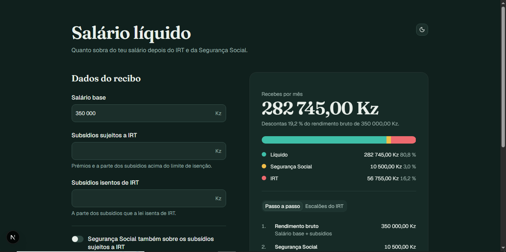

# Calculadora de Salário Líquido, Angola

Calcula o salário líquido a partir do salário base e dos subsídios, com **IRT (Grupo A)** e **Segurança Social**. Mostra o escalão aplicado e o passo a passo de cada conta.

**Demo:** _(link a acrescentar depois de publicar)_

[](https://github.com/Ismaelnexdev/calculadora-irt-angola/actions/workflows/ci.yml)
[](LICENSE)



## O que faz

- Calcula o líquido em tempo real, enquanto se escreve.
- Divide o rendimento bruto numa faixa visual: líquido, Segurança Social e IRT.
- Explica a conta passo a passo e destaca o escalão em uso na tabela do IRT.
- Permite escolher se a Segurança Social incide só sobre o salário base ou também sobre os subsídios sujeitos a IRT.
- Tema claro e escuro, e layout pensado para telemóvel.

## Como o cálculo funciona

```text
Segurança Social   = 3% × base de incidência
Matéria colectável = salário base + subsídios sujeitos a IRT − Segurança Social
IRT                = parcela fixa + (matéria colectável − excesso) × taxa do escalão
Salário líquido    = rendimento bruto − Segurança Social − IRT
```

### Tabela do IRT, Grupo A (2026)

Lei n.º 14/25, de 30 de Dezembro (Orçamento Geral do Estado para 2026).

| Matéria colectável (Kz) | Parcela fixa (Kz) | Taxa | Excesso sobre (Kz) |
|---|---:|---:|---:|
| Até 150 000 | 0 | 0 % | — |
| 150 001 a 200 000 | 12 500 | 16 % | 150 000 |
| 200 001 a 300 000 | 31 250 | 18 % | 200 000 |
| 300 001 a 500 000 | 49 250 | 19 % | 300 000 |
| 500 001 a 1 000 000 | 87 250 | 20 % | 500 000 |
| 1 000 001 a 1 500 000 | 187 250 | 21 % | 1 000 000 |
| 1 500 001 a 2 000 000 | 292 250 | 22 % | 1 500 000 |
| 2 000 001 a 2 500 000 | 402 250 | 23 % | 2 000 000 |
| 2 500 001 a 5 000 000 | 517 250 | 24 % | 2 500 000 |
| 5 000 001 a 10 000 000 | 1 117 250 | 24,5 % | 5 000 000 |
| Mais de 10 000 000 | 2 342 250 | 25 % | 10 000 000 |

## Decisões técnicas

- **A lógica fiscal está separada da interface.** `src/lib/tax` é TypeScript puro, sem React, por isso é testável e reutilizável.
- **As tabelas são dados com data de vigência** (`TaxRegime`), não regras espalhadas pelo código. A AGT anunciou que o IRPS deverá substituir o IRT a partir de 1 de Janeiro de 2027. Quando a tabela nova estiver publicada, acrescenta-se um regime novo, sem mexer nas funções de cálculo.
- **Valores inválidos lançam erro** (`RangeError`) em vez de produzirem resultados absurdos.
- **Testes sobre casos verificados**, incluindo o exemplo divulgado pela AGT (175 000 Kz de matéria colectável → 16 500 Kz de IRT) e as fronteiras entre escalões.
- **Formatação de valores fixa**, igual no servidor e no navegador, para evitar erros de hidratação.

## Limitações conhecidas

- **Base da Segurança Social:** as fontes consultadas divergem sobre se incide só no salário base ou em toda a remuneração regular. Por defeito usa o salário base, e há um interruptor para incluir os subsídios sujeitos a IRT.
- **Subsídios isentos:** o utilizador indica quanto é isento. Os limites legais de cada subsídio não são validados.
- **Salto no limite de isenção:** pela tabela publicada, com 150 000 Kz de matéria colectável o IRT é 0, mas com 150 001 Kz já é cerca de 12 500 Kz, porque a parcela fixa do 2.º escalão arranca logo. Está documentado num teste.
- Só cobre o **Grupo A** (trabalho por conta de outrem).

## Fontes e verificação

A tabela foi transcrita de fontes secundárias que coincidem entre si, e confirmada contra o exemplo da AGT acima. **Confirma sempre no Portal do Contribuinte (AGT) ou na legislação publicada.** Os valores são indicativos e não substituem o recibo de vencimento nem aconselhamento fiscal.

## Tecnologias

Next.js, React, TypeScript, Tailwind CSS, shadcn/ui, Vitest e GitHub Actions.

## Executar localmente

Requer Node.js 22 (LTS) ou superior.

```bash
git clone https://github.com/Ismaelnexdev/calculadora-irt-angola.git
cd calculadora-irt-angola
npm install
npm run dev
```

Abre <http://localhost:3000>.

| Comando | O que faz |
|---|---|
| `npm run dev` | Servidor de desenvolvimento |
| `npm test` | Executar os testes uma vez |
| `npm run test:watch` | Testes que se repetem a cada alteração |
| `npm run lint` | Verifica o estilo do código |
| `npm run typecheck` | Verifica os tipos |
| `npm run check` | Lint, tipos e testes |
| `npm run build` | Build de produção |

## Estrutura

```text
src/
  app/                    Página e layout
  components/             Interface (calculadora, faixa, tabela, passo a passo)
    ui/                   Componentes shadcn/ui
  lib/
    format.ts             Formatação e leitura de valores em kwanzas
    tax/
      types.ts            Tipos (escalão, regime fiscal)
      tables.ts           Tabelas fiscais com data de vigência
      calculate.ts        Cálculo do IRT e do salário líquido
      calculate.test.ts   Testes
docs/                     Imagens da documentação
.github/workflows/        Integração contínua (CI)
```

## Próximos passos

- [ ] Regime do IRPS, quando a tabela for publicada
- [ ] Validar os limites legais de isenção dos subsídios
- [ ] Exportar o cálculo em PDF
- [ ] Versão em inglês

## Licença

[MIT](LICENSE)